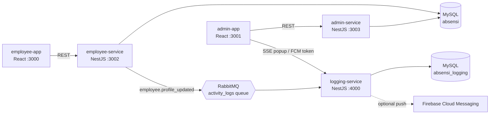

# Absents Management System — Absensi WFH Karyawan

Employee work-from-home attendance system built with **NestJS microservices**, **MySQL**, **RabbitMQ** and **React**.

- **Employee app** (`employee-app`): employees log in with their company email, clock in/out (Absen), view their attendance summary (Summary Absen) and manage their profile (Profil).
- **Admin app** (`admin-app`): HRD admins add/update employees, view everyone's attendance (read-only) and get a popup whenever an employee changes their profile.

## Architecture



| Service | Responsibility |
|---|---|
| `employee-service` | Employee login, profile (view; change photo, phone, password), clock-in/out, attendance summary. Publishes `employee.profile_updated` to RabbitMQ. |
| `admin-service` | Admin login, create/update/list employees, read-only attendance of all employees. Seeds the first admin account. |
| `logging-service` | Consumes RabbitMQ events, writes them to the **separate** `absensi_logging` database and notifies admins: Server-Sent Events popup (always) + FCM push (optional). |

The services live in one NestJS monorepo (`backend/`) and share code through `libs/common` (entities, JWT auth guard, RabbitMQ contract, upload config). They share one JWT secret, so authentication is stateless across services.

## Requirement checklist

| Requirement | Where |
|---|---|
| NestJS + TypeScript backend | `backend/apps/*`, `backend/libs/common` |
| MySQL with a proper structure | `users`, `attendances` (FK, unique per user/day/status), `activity_logs`, `devices` — see [Database](#database) |
| Microservices REST API consumed by both apps | 3 independent NestJS services |
| CRUD through the API | Employees (create/read/update), attendance (create/read), profile (read/update) |
| Login with company email + password | `POST /api/auth/login` on employee and admin services (role-checked, bcrypt) |
| Profil: name, email, photo, position, phone; change photo, phone, password | employee-app → Profil |
| Popup notification on the admin page when profile changes | admin-app `Notification.js` (SSE from logging-service; FCM optional) |
| Message queue logging to a separate database | RabbitMQ → logging-service → `absensi_logging.activity_logs` |
| Absen: date, time, status Masuk/Pulang | employee-app → Absen |
| Summary Absen: default first of month → today, date-range filter | employee-app → Summary Absen |
| Admin: add/update employees | admin-app → Data Karyawan / Tambah Karyawan |
| Admin: read-only attendance of all employees | admin-app → Absensi Karyawan |
| Responsive for laptop and mobile | Bootstrap 5 grid + responsive sidebar/top bar |
| CSS framework, custom components | Bootstrap 5; `components/ui/*` (Avatar, PageCard, DateRangeFilter, Pagination, Alert, LiveClock), `EmployeeForm` |

## Getting started

### Prerequisites

- Node.js 20+ (tested with 22)
- MySQL 8 and RabbitMQ 3 — easiest via Docker:

```bash
cd backend
docker compose up -d        # MySQL on :3306 (root/rahasia), RabbitMQ on :5672 (UI on :15672, guest/guest)
```

Without Docker, install them locally and create the two databases with `backend/database/init.sql`.

### 1. Backend

```bash
cd backend
cp .env.example .env        # adjust DB credentials / JWT_SECRET if needed
npm install

# in three terminals
npm run start:employee      # http://localhost:3002/api
npm run start:admin         # http://localhost:3003/api
npm run start:logging       # http://localhost:4000/api
```

Tables are created automatically (`DB_SYNCHRONIZE=true`). On first start, admin-service creates the HR admin from `.env`:
**`admin@company.com` / `admin123`**.

### 2. Frontends

```bash
cd admin-app && npm install && npm start       # http://localhost:3001
cd employee-app && npm install && npm start    # http://localhost:3000
```

API URLs are set in each app's `.env.development`.

### 3. Try it

1. Log in to the **admin app** and add an employee (e.g. `budi@company.com` / `secret123`).
2. Log in to the **employee app** with that account: clock in/out, check the summary.
3. Change the phone number, password or photo in **Profil** — the admin app shows a popup and a row is written to `absensi_logging.activity_logs`.

### Tests and checks

```bash
cd backend
npm test            # unit tests (vitest)
npm run typecheck
npm run build
```

## API

All routes are prefixed with `/api`. Protected routes need `Authorization: Bearer <accessToken>`.

### employee-service (:3002) — role `EMPLOYEE`

| Method | Path | Description |
|---|---|---|
| POST | `/auth/login` | `{ email, password }` → `{ accessToken, user }` |
| GET | `/profile` | Own profile |
| PATCH | `/profile` | `{ phone?, password? }` — publishes `employee.profile_updated` |
| POST | `/profile/avatar` | multipart `avatar` (JPG/PNG/WEBP/GIF, ≤ 2 MB) — publishes `employee.profile_updated` |
| POST | `/attendances/clock-in` | Once per day |
| POST | `/attendances/clock-out` | Requires clock-in; again on the same day moves the time |
| GET | `/attendances?from=YYYY-MM-DD&to=YYYY-MM-DD` | Per-day summary; defaults to first of the month → today |

### admin-service (:3003) — role `ADMIN`

| Method | Path | Description |
|---|---|---|
| POST | `/auth/login` | Admin login |
| GET | `/employees?page&limit&search` | Paginated employee list |
| POST | `/employees` | `{ name, email, position, phone?, password }` |
| GET | `/employees/:id` | Employee detail |
| PATCH | `/employees/:id` | Any of the create fields; password optional |
| POST | `/employees/:id/avatar` | multipart `avatar` |
| GET | `/attendances?page&limit&from&to&employeeId` | All employees' clock events (read-only) |

### logging-service (:4000) — role `ADMIN`

| Method | Path | Description |
|---|---|---|
| GET | `/notifications/stream?token=<jwt>` | Server-Sent Events stream of profile-change popups |
| GET | `/activity-logs?page&limit` | Logged profile changes |
| POST | `/devices` | `{ fcmToken }` — register a browser for FCM push |
| RMQ | `employee.profile_updated` | `{ userId, name, email, changedFields, occurredAt }` (never contains the password) |

## Database

**`absensi`** (employee-service, admin-service)

| Table | Columns |
|---|---|
| `users` | `id`, `name`, `email` (unique), `password` (bcrypt), `position`, `phone`, `avatar`, `role` (`ADMIN`/`EMPLOYEE`), `created_at`, `updated_at` |
| `attendances` | `id`, `user_id` → `users.id`, `date`, `time`, `status` (`IN`/`OUT`), timestamps; unique (`user_id`, `date`, `status`) |

**`absensi_logging`** (logging-service only)

| Table | Columns |
|---|---|
| `activity_logs` | `id`, `user_id`, `email`, `event`, `changed_fields`, `payload` (JSON), `occurred_at`, `created_at` |
| `devices` | `id`, `fcm_token` (unique), `admin_id`, timestamps |

Attendance dates and times are recorded in `APP_TIMEZONE` (default `Asia/Jakarta`).

## Optional: Firebase push notifications

The popup works out of the box over SSE. To also get OS-level push notifications while the admin tab is closed:

1. Create a Firebase project with Cloud Messaging and a Web Push (VAPID) key.
2. Backend: download a service-account JSON and set `FIREBASE_SERVICE_ACCOUNT_PATH` in `backend/.env`.
3. Admin app: put the `REACT_APP_FIREBASE_*` values (listed in `admin-app/.env.development`) in `admin-app/.env.development.local`.

## Project structure

```
backend/                     NestJS monorepo
  apps/employee-service/     auth, profile, attendance
  apps/admin-service/        auth, employees, attendance, admin seeder
  apps/logging-service/      RabbitMQ consumer, activity logs, notifications (SSE/FCM), devices
  libs/common/               entities, auth guard/decorators, RMQ contract, uploads, utils
  docker-compose.yml         MySQL + RabbitMQ
employee-app/                React app for employees
admin-app/                   React app for HRD admins
```
